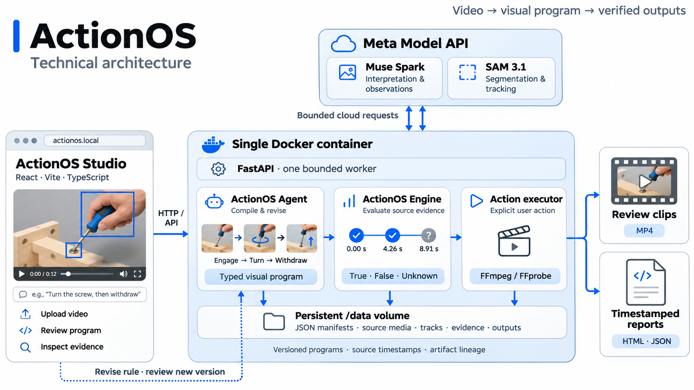
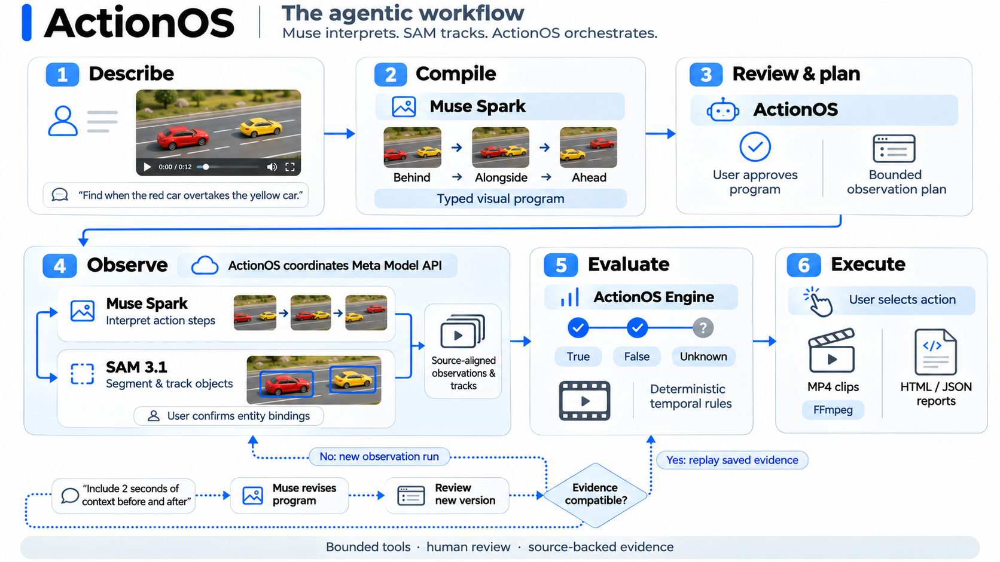

# ActionOS

ActionOS is a visual programming system for uploaded video. A user describes a real-world event or sequence, reviews a typed visual program, evaluates it against source-backed observations, and explicitly executes a clip or timestamp report. ActionOS Studio is the web workspace; ActionOS Agent is the bounded compiler/planner; ActionOS Engine/API performs perception, temporal evaluation and actions. WorldCut is its clipping capability.

## Run locally

Requires Python 3.11+, Node 22.12+ or 24+, and FFmpeg/FFprobe with `scdet` and `metadata` filters on PATH. Upload, compile, review, then explicitly run the program. Select entity segments, evaluate saved evidence, and select events for clips or reports.

```powershell
python -m venv .venv
.venv/Scripts/python.exe -m pip install -r requirements.txt
.venv/Scripts/python.exe -m uvicorn app.main:app --app-dir backend --host 127.0.0.1 --port 8000 --workers 1
```

In another terminal:

```powershell
cd frontend
npm.cmd ci
npm.cmd run dev
```

Open the Vite URL, normally `http://127.0.0.1:5173`; `/api` proxies to port 8000. For same-port static/API serving, run `npm.cmd run build` in `frontend`, then open `http://127.0.0.1:8000`. On Unix use `.venv/bin/python` and `npm`. Run one process/worker per data directory; production reload is unsupported.

## Configuration and container target

Copy `.env.example` to root `.env`. Put the Meta credential in `MODEL_API_KEY`; local startup loads that file, with shell variables taking precedence. Restart the backend after changing it. Keep keys server-side and out of frontend variables, logs and source control.

| Setting | Existing default or behavior |
| --- | --- |
| `META_API_BASE_URL` | `https://api.meta.ai/v1` |
| `MUSE_MODEL`, `SAM_MODEL` | Account-tested baseline: `muse-spark-1.3`, `sam-3.1` |
| `DATA_DIR`, `APP_PORT` | Local `./data`, port `8000`; container storage `/data` |
| `MAX_UPLOAD_MB`, `MAX_VIDEO_SECONDS` | 150 MiB, 120 seconds |
| `MAX_CONCURRENT_JOBS`, `MAX_QUEUED_JOBS` | One active job and eight additional pending jobs |
| `MEDIA_TIMEOUT_SECONDS`, `MAX_INPUT_PIXELS` | 300 seconds per media operation; 8,294,400 pixels |
| `MAX_PROJECT_MB`, `MIN_FREE_DISK_MB` | 2048 MiB project budget; 256 MiB reserve for monitored media work |
| `MAX_CACHED_FRAMES` | 600 evidence frames |

The DSL policy freezes AST/observation/action quotas. Admission checks exist; owning compiler/evaluator/action implementations still need their full validators. Media limits do not establish engine capacity or provider maximums.

```powershell
docker build -t actionos-studio .
docker run --rm -p 127.0.0.1:8000:8000 -v actionos-data:/data --env-file .env -e DATA_DIR=/data -e APP_PORT=8000 actionos-studio
```

The image tag is a deployment name; until migration is implemented it still contains the inherited application. Container acceptance remains unverified. The image is designed for one static/API origin and UID 10001; bind mounts must be writable by that user. The data-path override prevents local `.env` settings from bypassing the volume.

## Architecture


## ActionOS agentic workflow


## ActionOS demo
[![Watch Demo]](https://youtu.be/axjYUg0_eSM)

## Verification

```powershell
.venv/Scripts/python.exe -m pip install -r requirements-test.txt
.venv/Scripts/python.exe -m pytest --basetemp=.tmp/pytest -q
cd frontend
npm.cmd test
npm.cmd run build
```
